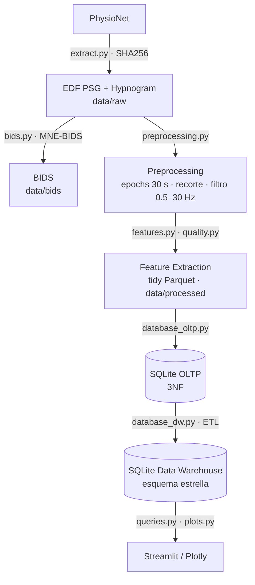

# Complejidad y actividad espectral del EEG en las etapas del sueño

Pipeline reproducible de Ingeniería de Datos sobre EEG de sueño público (Sleep-EDF Expanded, PhysioNet):
descarga automática, organización BIDS, ETL en épocas de 30 s, métricas espectrales y de complejidad, control de
calidad, base SQLite transaccional (3NF), Data Warehouse en esquema estrella, consultas SQL, visualizaciones Plotly
y dashboard Streamlit.

*Trabajo Práctico Final — Introducción a la Ingeniería de Datos.*

## Preguntas de investigación

> 1. ¿Cómo varían la complejidad y la actividad espectral del EEG entre las distintas etapas del sueño?
> 2. ¿Cómo difiere la potencia sigma en N2 entre personas de distintas edades?

El foco del trabajo es el **pipeline de datos**; la pregunta neurocientífica es el caso de estudio. Los resultados son
descriptivos (sin inferencia estadística).

## Dataset

[Sleep-EDF Expanded](https://physionet.org/content/sleep-edfx/1.0.0/) (Kemp et al., 2000; DOI
[10.13026/C2X676](https://doi.org/10.13026/C2X676)), subconjunto *sleep-cassette*: polisomnografías de personas
sanas con hipnogramas puntuados por expertos. Se usan los canales EEG **Fpz-Cz** y **Pz-Oz** (100 Hz).

Por defecto se procesan **18 sujetos × 2 noches**, estratificados por sexo y edad: 3 mujeres y 3 hombres en cada
grupo etario (<40, 40-64 y 65+), de 26 a 101 años. La muestra la elige el código (`extract.select_subjects`) con una regla que usa solo edad,
sexo y cantidad de noches; `SUBJECTS_PER_GROUP` en `src/config.py` fija cuántos sujetos por grupo y sexo (3 = 18 sujetos,
hasta 8 = 48). Los archivos se descargan programáticamente y se verifican contra los SHA256 oficiales.

## Arquitectura



## Estructura del repositorio

```
├── data/
│   ├── raw/          EDF originales + manifest de descarga (no versionado)
│   ├── bids/         dataset organizado según BIDS (no versionado)
│   ├── processed/    tablas Parquet, versiones del entorno y caché por registro (no versionado)
│   └── database/     sleep_oltp.sqlite y sleep_dw.sqlite (no versionado)
├── notebooks/
│   └── TP_final.ipynb   documento principal del TP
├── src/
│   ├── config.py         rutas, selección de sujetos, parámetros y umbrales
│   ├── extract.py        descarga validada desde PhysioNet
│   ├── bids.py           conversión a BIDS
│   ├── preprocessing.py  lectura EDF, validación, epochs, filtrado
│   ├── features.py       potencias de banda, Sample Entropy, RMS, pico a pico
│   ├── quality.py        artefactos y outliers de Tukey (marcas y resumen)
│   ├── pipeline.py       orquestación del Transform con caché
│   ├── database_oltp.py  base transaccional 3NF
│   ├── database_dw.py    ETL al Data Warehouse
│   ├── queries.py        consultas analíticas SQL
│   ├── plots.py          figuras Plotly
│   ├── validation.py     validaciones automáticas
│   └── dashboard.py      dashboard Streamlit
├── requirements.txt
└── README.md
```

Los datos no se versionan: todo `data/` se reconstruye desde la fuente pública al ejecutar el notebook.

## Instalación

Requiere Python ≥ 3.10.

```bash
git clone https://github.com/Mpretel/IID_MP.git
cd IID_MP/TP/tpf
python -m venv .venv
# Windows: .venv\Scripts\activate    ·    Linux/macOS: source .venv/bin/activate
pip install -r requirements.txt
```

| Dependencia          | Uso                                                             |
| -------------------- | --------------------------------------------------------------- |
| numpy, pandas, scipy | Cálculo numérico, tablas, PSD de Welch                        |
| mne, mne-bids        | Lectura EDF, filtrado, organización BIDS                       |
| antropy              | Sample Entropy                                                  |
| pyarrow              | Parquet                                                         |
| xlrd                 | Lectura de `SC-subjects.xls` (metadatos oficiales de sujetos) |
| plotly, streamlit    | Visualización y dashboard                                      |

SQLite se usa mediante el módulo `sqlite3` de la biblioteca estándar.

## Ejecución local

Abrir `notebooks/TP_final.ipynb` (VS Code o Jupyter) y ejecutar todas las celdas. El notebook descarga los datos,
genera BIDS, procesa los registros, construye ambas bases, ejecuta las consultas y muestra el EDA.

- Primera ejecución con 18 sujetos × 2 noches: ~40–45 min y ~3,5 GB de disco, casi todo en el cálculo de Sample Entropy. Las
  ejecuciones siguientes reutilizan las descargas y el caché por registro y tardan segundos.

## Ejecución en Google Colab

1. Abrir el notebook en Colab:
   [colab.research.google.com/github/Mpretel/IID_MP/blob/main/TP/tpf/notebooks/TP_final.ipynb](https://colab.research.google.com/github/Mpretel/IID_MP/blob/main/TP/tpf/notebooks/TP_final.ipynb).
2. *Runtime → Run all*. La primera celda detecta Colab, clona el repositorio, se ubica en `TP/tpf` e instala `requirements.txt`.
